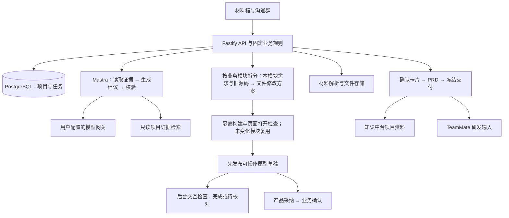

# 需求协作工作台 · 本地第一版

需求助手采用轻量回应与按需深入评估：复杂规则、方案取舍或明确的多视角请求会显示评估卡片，可展开查看 PM、业务分析、UX 的意见、方案影响与原文依据。详见 [实施规则与验收计划](docs/EXPERT_DISCUSSION.md)。

两个入口：**材料箱、沟通群**。沟通群为左侧需求池、中间多人和 Agent 讨论、右侧原型 / PRD 预览。顶部保留项目、当前身份和导出；阶段、版本与整体评审收在“导出 → 版本与整体评审”。

## 打开与运行

按[部署说明](部署说明.txt)启动后，访问 http://127.0.0.1:4318。首次安装后新建项目并上传自己的材料；仓库不包含本地项目、上传材料、聊天记录、生成原型或验收数据库。本地升级保留原有项目、材料、历史版本及模型配置。模型配置变动后可运行 `pnpm model:check` 检查连通性，该命令会发起真实模型请求。

真实配置仅保存在未纳入版本管理的 `.env` 中；仓库只提供不含密钥的 `.env.example`。`data/`、`.work/`、本地验收记录、数据库备份、导出包、构建产物及私钥均被忽略。`certs/` 中的 PEM 文件仅为公开 CA 证书，不包含私钥。源码中的 CRM 样例和测试夹具为合成数据。

确认、概要更新和模块共享业务数据的规则见 [确认与原型更新规则](docs/CONFIRMATION_AND_PROTOTYPE.md)。

## 开发架构与组件

| 位置 | 组件 | 第一版职责 |
| --- | --- | --- |
| 浏览器 | React 19、TypeScript、Vite 8、Lucide | 两个工作区、三栏协作、交互演示和统一确认 |
| 应用服务 | Node.js、Fastify 5、Zod 4 | API、会话、权限校验、输入校验、状态与版本规则 |
| Agent | Mastra Core 1.79、可配置的模型网关 | 概要与具体候选抽取、概要细化、讨论总结与字段修改建议 |
| 持久化 | PostgreSQL 16、pg | 项目数据、后台任务、确认记录、版本快照、交付记录 |
| 文件 | 本地文件目录 | 上传原件、最终 PRD、本地验收回执 |
| 材料解析 | Mammoth、pdf-parse、ExcelJS、sharp、yauzl | 文档正文、模型图片识字（需模型支持视觉）、ZIP 按文件展开 |
| 导出 | docx、fflate | PRD Word / Markdown、项目 Demo 源码和可离线运行的构建产物 |
| Demo 生成 | Mastra、React / Vite、Docker、Chromium | 根据需求生成或增量修改源码，在隔离环境构建并执行交互检查 |
| 外部交付 | HTTP JSON 适配器 | 冻结最终 PRD、幂等键、接收回执、失败目标重试 |

首期为一个应用服务加一个数据库容器。模型任务在应用后台执行，任务状态写入 PostgreSQL。正式业务更新使用 JSONB 聚合、事务、项目行锁和版本戳；高频讨论使用独立追加表，卡片、消息、材料和工作区摘要使用同步维护的关系读表。浏览器通过游标增量同步，SSE 通知变化，断线时仍每 3 秒补查。部署、接口和压测说明见 [规模与性能](docs/SCALING.md)。



### 固定流程与灵活调度

- **固定规则由应用控制**：九字段、卡片类型、建议人工审核、同修订同轮确认、阶段回退、整体评审、版本递增与交付冻结。
- **Mastra 固定短流程**：读取当前证据 → Agent 生成 → 结构与原文引用校验。格式或证据失败最多修复一次；不合格结果不写入卡片。
- **模型调用**：顶部“模型”可选择九个预设网关模型并检查连接；产品经理保存后全工作台生效，选择持久化到数据库，存在运行中任务时禁止切换。未保存选择时使用 `.env` 的 `MODEL_NAME` 精确请求名；Kimi K3 / DeepSeek V4 系列额外使用 `reasoning_effort: low`。单次任务有超时与一次校验修复上限，工具不兼容时最多降级一次；关闭 SDK 独立的隐式错误重试，失败原因经过安全分类后显示。
- **较多材料分批整理**：超过 4 份可读材料或 2,000 字时，先结合完整材料梳理需求清单，再每次补全最多 2 张卡片（最多同时处理 2 批），页面显示完成进度。各批仍能看到完整材料和需求关系；全部通过字段与原文校验后才一次保存草稿。小任务遇到超时或截断时自动切换此流程一次，失败仍保留原材料，重试沿用原材料选择。
- **步骤内允许灵活选择**：使用只读检索工具补充项目证据、判断哪些字段需追问和联动修改。工具不允许改库、审批或交付。
- **长时间等人由数据库承接**：建议保存为待决定；用户采纳、确认或提出问题后由业务 API 推进。第一版不把跨天的人工作业留在内存中的 Agent 会话里。

## 使用流程

1. 顶部“新建项目”创建项目。在材料箱上传资料，分析、编辑、核对需求草稿后“加入沟通”。
2. 在沟通群左侧选一项需求，直接讨论后回车发送，Shift + Enter 换行。Agent 会在必要时追问一个关键点，并显示等谁回复；被询问的人可点选方案填入输入框，调整后发送，也可自由回答。可输入 `@Agent` 提问，或点击“整理讨论”主动整理。
3. Agent 结合讨论形成结论，右侧展示原型及“需求草稿 · 待采纳”状态。团队可直接操作原型核对流程、权限与异常处理，原型操作不会改变需求确认。
4. 产品默认一次“采纳并发起确认”。只在不认可部分内容时点“调整”。界面在采纳前说明已有确认失效与阶段回退；若问题尚未解决，则仅采纳结论、继续沟通。
5. 顶部切换业务身份，结合结论与演示点击“确认本轮需求”；也可“需要调整”，说明后重新沟通。其余需求继续在左侧切换。

### 讨论、演示与卡片联动

- **原型自适应预览**：手机端保持竖版、桌面端保持横版，在右侧可用区域等比缩放并居中；窗口或分栏尺寸变化自动适配，长页面只在原型内部滚动。放大预览同样受窗口宽高约束。新生成原型声明设计视口，构建时检查页面横向溢出，避免用固定宽度撑开工作台。已有项目无需重新生成即可使用适配容器。
- **聊天中添加材料**：产品与业务人员都可用输入框的附件按钮、拖放文件或粘贴图片补充材料，无需先切换材料箱。支持现有文档、图片和 ZIP 格式；每次最多 5 个文件，普通文件各 10 MB、ZIP 各 30 MB，合计不超过 50 MB。发送后保留原件、发送人和所属讨论，原件也可在材料箱查阅。Agent 根据本轮问题和材料决定直接回应、澄清当前卡片或提出独立新卡草稿，可同时给出多种建议。当前卡片修改仍待产品采纳；新卡跳转现有材料箱编辑器，由产品核对后加入沟通，不自动入池或确认。未读成功的内容明确提示，失败可重试，重试不会重复添加相同材料消息。
- **主动追问与等待提醒**：普通发言会合并触发后台分析，闲聊不触发；每张卡片同时只等待一个关键问题。需求池与聊天顶部显示等谁补充，产品发起确认后显示等业务确认。回复只是讨论证据，不能代替产品采纳或业务确认；关键问题未明确时不能发起新的确认。
- **讨论生成进度与恢复**：听取讨论和生成建议使用流式接收，工作台显示等待响应、已接收字数和结构校正进度；完整校验后才发布建议。依赖的无歧义格式偏差先自动归一化，其余依赖结构错误只修复该部分。长输出最多精简重试一次；“重新分析”可以重试已读但后续失败的讨论。DeepSeek V4 与 Kimi K3 通道显式使用 `low` 思考强度，控制等待与输出预算。
- **原型与卡片双向定位**：聊天标题和卡片字段旁的定位按钮指向 Demo 对应区域；点击 Demo 的相关区域显示关联需求，可查看卡片或带着该位置继续讨论，不打断原来的演示操作。Agent 生成代码时同时返回需求与页面元素的映射，构建器验证这些区域可定位；演示中的点击仅定位卡片，不触发需求确认。旧 CRM / 大会模板保留为明确标记的预置样例。
- **更新变化摘要**：演示上方默认只显示本轮变化数量，展开可看改了哪些规则、前后原文，并定位相关区域。未采纳建议标为草稿，PRD 正文在产品采纳后才更新。
- **项目 Demo 自动生成与更新**：材料草稿保存入池或讨论形成字段建议后，Agent 按业务模块生成独立 React 工程。生成前统一项目业务实体、状态和关联 ID，各模块使用同一业务数据定义与内存状态。每次传入本模块需求、源码和上下游需求；预览阶段只返回代码差异与定位；检查清单的生成与执行均后置，未改变内容保留。已有数据定义可直接复用，新增实体或持久字段时由 Agent 请求统一更新数据定义。相同接口下只重建变化模块，数据定义改变或依赖被移除时联动更新。最多两个模块并行生成，构建及页面打开检查通过后先发布可操作修订，完整交互检查在后台继续。
- **按需预览与数据**：原型由可信导航壳加载当前模块，切换时才请求其他模块；每个产物有固定地址和浏览器私有缓存。PRD、材料箱和放大预览切换保留同一个原型实例；模块表单与记录通过有容量限制的内存模拟存储保持，刷新、重置或数据定义改变后清空。同一数据定义下更新模块保留当前页面和已有输入、业务记录，不重载整个原型。聊天按页读取，材料原文、完整卡片历史和评审历史按需读取。
- **人工采纳与版本对应**：代码生成不改卡片正文、确认或阶段。待采纳建议可先预览，PRD 仍使用正式字段。全部采纳且内容完全一致时复用原型与其真实检查状态；部分采纳或人工改写后按最终需求重新生成。生成期间有效需求或有效建议改变时取消旧模型请求；没有改变需求的普通聊天不废弃同内容原型；未同步时保留上一版并标明，不允许冒充当前版本导出。
- **检查与失败处理**：每次使用无网络、无模型密钥、非 root 的 Docker 容器；固定 React/Vite 依赖与构建入口，模型只能修改 src 内文件。构建后在 sandbox iframe 中检查页面能否打开、非空及横向布局；此阶段失败最多修复两轮，仍失败保留上一版。发布后后台生成受影响的增量检查，再执行完整定位与交互检查，界面单独标为“检查中 / 检查完成 / 待核对”，详情收在变化面板。后台失败不隐藏可用预览、不自动修改代码、不影响人工确认；下一次更新会带着失败记录修复。服务重启会恢复当前修订未完成的后台检查。示例数据在内存中，不连真实业务系统。
- **产物**：`data/demos/<project>/<artifact>/` 保存模型文件方案、源码、构建 HTML、检查报告和截图；数据库保存不可变演示修订及需求关联。导出 ZIP 包含当前预览、源码、需求映射、PRD、verification.json 检查状态和运行说明。草稿导出会明确告知 Demo 中尚未采纳的内容不会进入 PRD。
- **人工决定优先**：分析期间继续发言、修改卡片或人工确认，过期结果会被丢弃；失败保留聊天，可以继续讨论或手动重新整理。新项目只增加会话辅助信息，沿用原有字段、四阶段和版本规则。
6. 右上角导出 PRD Word、Markdown 或可离线运行的 Demo ZIP。未明确的项目输出标注未确认项的草稿；正式 PRD 使用评审冻结快照。待采纳的 Agent 建议不进入 PRD。
7. 全部本期需求明确后，从“导出 → 版本与整体评审”完成评审；配置接收接口后再交付知识中台和 TeamMate。下载不是交付。

界面已移除体验说明、预置结论入口和本地验收交付按钮。模型服务不可用时显示失败原因并支持重试，不提供预置脚本替代入口。已有项目、历史消息和历史回执仍保留，原型预览、更新、代码导出及人工确认流程继续可用。

### 原型生成与更新

可从沟通群打开、更新或导出已有原型。第一次生成和较大更新可能需要数分钟，失败时保留上次可用原型。产品经理可审核修改建议，业务人员可独立确认。原型使用模拟数据，PRD 使用已保存字段或正式冻结版。

### 模块与沟通顺序

材料箱抽取时让 Agent 建议模块归属、沟通优先级及一句理由，产品经理可以直接修改；选择“加入沟通”时一并保存，无需再逐项确认。优先级固定为 **优先沟通 / 正常沟通 / 后续沟通**，表示讨论的先后，不表示开发排期或需求是否纳入本期。已入池草稿只读，显示正式卡当前的安排；后续在沟通群标题下的“调整安排”修改。

沟通群左侧只显示具体需求，概要保留在材料箱，不计入左侧数量和搜索。每张需求旁的小红旗控制置顶，再点一次取消；没有置顶时不显示“置顶聊天”。置顶按当前身份保存，卡片从普通列表移到顶部，同一聊天不重复显示；确认后仍保留主动置顶。材料箱的沟通优先级不会自动转成置顶。

模块旁的铅笔可重命名，产品经理统一维护项目分类。列表标题旁的“…”提供“不分组 / 按模块分组 / 自动归类”。没有多个有效业务模块时默认平铺；不分组只改变展示方式，保留已有模块信息。自动归类使用当前模型分析全部具体需求，先展示方案，经产品点击应用后更新；方案过期或模型失败时保留现有分类。无法形成清晰模块时，Agent 可以建议不分组。自动归类只更新具体卡的模块，不移动概要或改变置顶、业务内容。

“待处理”收起未置顶的已确认卡；刚确认的当前卡仍留在原处，离开后收起。“全部”和全项目搜索始终可找到历史卡。普通消息本身不重开；出现新 Agent 建议时回到待处理并显示“有建议待采纳”，显式变更提议显示“有变更待处理”。待处理不等于撤销确认；产品实际采纳正文变更后才回退阶段并要求受影响卡重新确认。全部拒绝建议会保留原确认并从待处理收起。置顶、重命名、归类和调整沟通优先级均不修改九字段、卡片修订、确认、阶段或冻结版本。

## 固定业务规则

- 粒度仅两层：概要卡组织目标、范围和共同约束；具体卡对应一个可独立判断范围与验收的业务结果，不按按钮、接口或字段机械拆卡。
- 材料箱管理候选草稿；抽取和保存草稿不改变正式范围。人工入池或统一确认排除范围后，才更新正式范围并回到可讨论，无关卡片的已有确认保持。
- 具体卡入池可为可确认、待澄清或需评估；已入池的材料草稿只读，编辑统一在正式卡进行。概要不参与整卡确认、不作为具体需求重复写入 PRD；共同约束由相关具体卡承接。概要业务字段变更会要求本期子卡重新核对，单纯修改标题或剩余事项不撤销子卡确认。
- 未入池的材料要求须继续处理或明确排除；概要的剩余范围和未处理子卡均会阻止整体评审。排除理由先作为草稿保存，统一确认后进入最终 PRD；草稿中的再次编辑不改已明确文档，快照固定当时内容。
- 概要支持继续细化，仅生成新增候选供人选择。相关已有卡只提示关联，不自动覆盖；经核对可记录已由原卡覆盖的理由。

- 类型：`功能要求`。九字段：业务目标、场景与范围、功能与流程、权限规则、异常处理、数据要求、依赖约束、质量要求、验收条件。
- 卡片状态：需评估、待澄清、可确认、已确认、本期不纳入。状态由内容、阻断、范围和确认计算，不允许手工任意切换。
- 产品与业务确认单卡，评审人员评审整份 PRD。Agent 不具备确认权，也不能自行关闭问题。
- 问题解决建议必须引用当前卡片的有效人类发言；业务口径需业务意见，制度与权限冲突需业务与评审意见。字段修改和勾选问题在同一事务中保存；缺少依据、依赖字段未采纳、旧修订或旧讨论的建议不能执行。仅关闭已被正文覆盖的问题不新增正文修订。普通“应用建议”仍不确认；沟通群显式点击“采纳并发起确认”时，在同一事务中按原门槛完成产品确认，业务仍须独立确认，不自动提升项目阶段。
- 普通聊天不回退，但使尚未采纳的旧建议失效；建议绑定卡片修订和消息基线。
- 采纳正文修改、记录阻断、业务要求修改、调整本期范围、产品纳入变更，会回退当前稿。仅当具体关联修改不一致时保留对应问题，独立字段的部分采纳不新增泛化阻断。人工调整的字段记录调整行为，不沿用 Agent 引文充当新内容依据；涉及问题解决结论时需重新总结核对。
- PRD 版本采用 `V交付号.明确号.评审号`。例如 `V0.0.1 → V0.1.0 → V1.0.0`；变更后为 `V1.0.1 → V1.1.0 → V2.0.0`。卡片修订单独递增。
- 历史快照冻结正文、来源、确认和范围。整体评审退回后，未调整内容或范围不能原样再次送审。
- 交付冻结后完成或重试该版本，不能夹带新内容。两端都成功才已交付；单端失败仍已明确，仅重试失败目标。

## 第一版边界

- Demo 已支持按项目需求生成与修改 React 前端代码，首版范围是使用模拟数据的可交互原型；不生成生产后端、支付、真实账号或正式权限系统。固定依赖范围内可生成新页面和交互，扩展第三方组件需要维护构建器。自动检查不代替人工验收，未确认规则不因页面可运行而自动生效。

- 监听地址固定 `127.0.0.1`，身份切换用于本地协作验收；服务端仍校验每个角色的操作权限。它不是正式账号认证或企业 SSO。
- 支持 TXT、MD、CSV、DOCX、文字 PDF、XLSX，单文件 10 MB、正文 16 万字符。扫描 PDF 和音视频仍需先识别/转写；解析失败保留原文件和原因。
- 图片支持 PNG、JPG/JPEG、WebP、单帧 GIF、单页 TIFF，单图 10 MB / 3000 万像素。后台识别可见文字，保留原图供核对；不清楚的内容不补造。无文字或识别失败会显示原因，可重试；成功后再选择材料生成需求草稿。
- 压缩包支持 ZIP，单包 30 MB，最多 100 个条目、展开总量 50 MB、单文件 10 MB。每个文件独立保留来源路径和处理结果；不支持、加密、嵌套包或不安全路径会标明原因。RAR/7Z 请先解压或转 ZIP。图片子文件独立后台识别，失败只重试该图片，不重复展开整包。
- 知识中台与 TeamMate 的真实接收接口需要按 [交付协议](docs/DELIVERY.md) 联调，当前不宣称已连通两平台。只向外发送最终 PRD，中间材料、聊天和建议不复制过去。
- 相似/冲突识别由模型提出，人决定是否采纳或移出本期。真实性校验能检查引用是否来自原文，不能代替人的业务判断。
- 后台任务中断后标记失败并允许重新发起；冻结交付保留成功端和原版本，失败端可幂等重试。

## 开发与验证

主题、文字、字号和空间尺度集中在 `src/design-tokens.css`，公共界面规则位于 `src/ui-guidelines.css`，弹窗统一使用 `src/workspace-ui.tsx`。

```sh
pnpm test
pnpm build
pnpm demo:verify
pnpm demo:verify-modules
pnpm load:test
```

领域测试覆盖确认权限、过期建议、建议选择与人工调整、回退、历史冻结及版本管理；集成测试使用独立临时 PostgreSQL 数据库，覆盖并发版本戳、HTTP 回执与失败重试。模型单测使用本地假网关，不消耗模型额度；真实模型验收记录另行保留在本地。

`demo:verify-modules` 用固定合成源码和真实 Docker / Chromium 检查模块按需下载、共享模拟状态、切换保留及导出源码重建。`load:test` 创建独立临时 PostgreSQL 数据库，使用真实 HTTP，结束后清理；关闭付费模型与外部交付，默认报告为 `.work/scaling/load-test.json`。详细参数、预算与实测见 [规模与性能](docs/SCALING.md)。

源码入口：`src/App.tsx`（入口）、`src/collaboration-workspace.tsx`（三栏协作）、`server/demo-modules.ts`（模块规划与复用）、`shared/prototype-shell.ts`（按需预览）、`server/demo-generator.ts`（Demo 编程 Agent）、`server/demo-jobs.ts`（版本与任务）、`scripts/demo-runner/runner.mjs`（隔离检查）、`server/workspace-sync.ts`（增量投影）、`server/read-model.ts`（热数据读写）、`server/metrics.ts`（耗时监测）、`server/store.ts`（事务存储）。

## 模型网关证书

本次检查发现网关未提供完整证书链。项目 `certs/model-chain.pem` 补齐公开的 Let's Encrypt YE1 与 Root YE 交叉签名证书，并已使用 Node 内置根证书验证到 ISRG Root X2。仅本应用通过 `NODE_EXTRA_CA_CERTS` 使用，不修改系统信任设置，也不关闭 TLS 或主机名校验。网关修复 fullchain 后可移除这一补充配置。

技术依据：[Mastra Agents](https://mastra.ai/docs/agents/overview)、[Mastra Workflows](https://mastra.ai/docs/workflows/overview)、[Let's Encrypt 证书链](https://letsencrypt.org/certificates/)。


### 模型选项

顶部“模型”支持 `deepseek-v4.1-flash-1017`、`cmft-qwen3.8-flash-next`、`CMFT-glm-5.3-flash`、`cmhk-deepseek-v4-flash`、`qwen3.8-max`、`glm-5.3`、`kimi-k3.1-pro`、`gpt-6-sol`、`claude-opus-5-5`；保留网关 ID 大小写，也保留环境变量指定的自定义默认模型。使用同一 MODEL_BASE_URL / MODEL_API_KEY，不向浏览器暴露密钥。选择适用于需求对话、深入评估、材料文本整理及原型生成；不自动回退到另一个模型。连通性检查只发送合成 JSON 提示，不证明全部任务或工具调用均兼容。

图片识别独立使用 `VISION_MODEL_NAME`，未配置时保留原 `MODEL_NAME`，再回退到 `kimi-k3.1-pro`。选择文本模型不改变图片识别模型；是否支持图片需要网关实际配置确认。


思考参数按模型处理：Kimi K3 / DeepSeek V4 使用 low；GPT-6 Sol 纯文本使用 low，当前 Chat Completions 接口带工具请求使用 none（[官方接口说明](https://developers.openai.com/api/docs/guides/deployment-checklist)）。Qwen、GLM、Claude 的五个列出通道已按当前网关实测适配 `reasoning_effort: low`；不透传未经验证的原生开关。Qwen Flash 的低思考参数可用，但复杂评估的 JSON 输出不稳定；JSON object 模式也出现重复输出，未启用。详见 [模型适配验证](docs/MODEL_COMPATIBILITY.md)。模型设置展示实际策略；请求被接受不代表网关一定执行了该思考级别。

讨论结构校验现在把具体字段位置及回答人/引用/选项规则反馈给唯一一次修复调用；二次失败向用户显示安全的具体原因，不降低证据标准、不保存失败结果。历史笼统错误没有保留原始输出，不能据此断定为思考预算问题。
